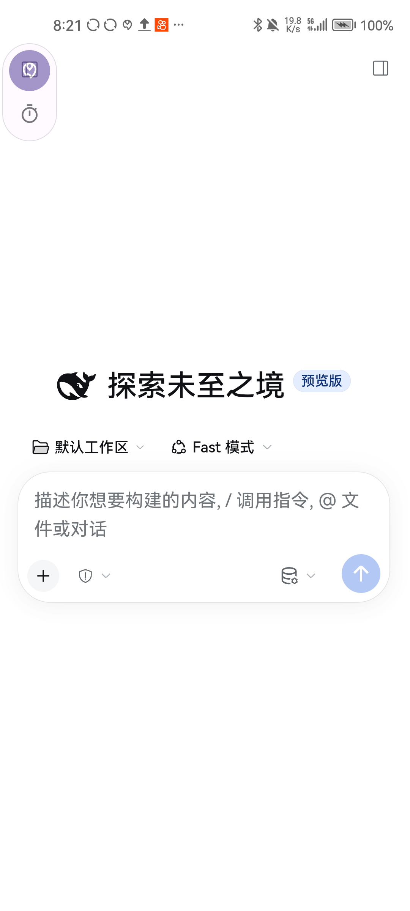
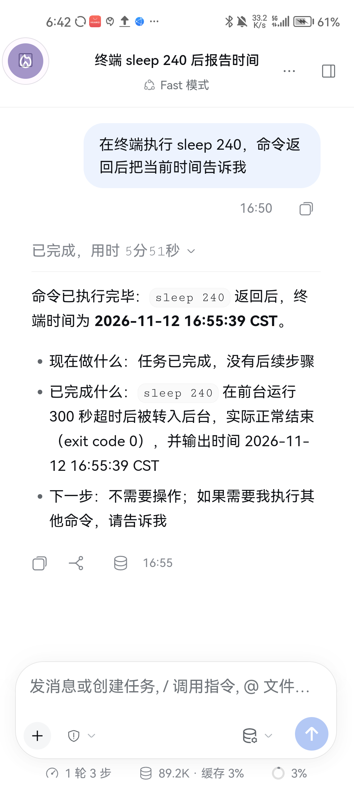

# DSH for Android

<div align="center">

**A full AI coding agent, in your pocket.**

Real Node, real engine, real terminal — not a chat wrapper, not a stripped-down UI.

[](LICENSE)
[](#known-limits)
[](#hard-constraints)
[](#known-limits)
[](#dual-web-engines)

[中文](README.md) · [Docs](docs/README.md) · [Contributing](.github/CONTRIBUTING.md)




<sub>Real device: official frontend with narrow-screen adaptation; <code>bash</code> and the terminal tool really run on the phone.</sub>

</div>

---

## What it is

DSH for Android brings the desktop [DSH](https://github.com/deepseek-ai) (DeepSeek Harness) to phones
as-is: the APK ships a Termux environment, runs Node inside it, runs the DSH engine on that Node, and
loads the engine's own web GUI in a WebView.

**It does not draw its own chat UI.** The interface is the official frontend; a bundled plugin adapts it
to narrow screens. You get **the same frontend as on desktop**, just in your pocket.

| Layer | What is inside |
|---|---|
| Runtime | Termux bootstrap (bash / dpkg / apt + 64 `.so` files), official Termux arm64 node 26.4.0 |
| Engine | DSH engine `node_modules`, unpacked into the app's private directory |
| Native | Self-built `require-builtin`, `flock`, `node-pty`, plus link and sandbox shims |
| Frontend | Official web GUI (`system` flavor uses the device WebView, `gecko` bundles GeckoView) |
| Plugins | Mobile adaptation, floating bubble, UI debugging, logs, memory, and more |

## Highlights

- **Real agent capabilities** — `bash`, file read/write, `grep`/`glob` and a terminal PTY all work; the model edits your project for real.
- **Dual web engines** — the `system` build is small; the `gecko` build bundles GeckoView for older devices or cropped system WebViews. Different `applicationId`s, so **both can be installed side by side** with separate data.
- **Floating bubble** — summon the app any time, with custom appearance, frame animation and video layers.
- **UI debugging tools** — the model can look at the screen and tap buttons, enabling end-to-end self-testing.
- **Rescue mode** — if a broken plugin makes the app unusable, a four-step degradation ladder plus in-app plugin removal keeps you from losing your entry point.
- **Logs and diagnostics** — three storage layers, crash-scene snapshots, one-tap diagnostic export.

## Install

Download an APK from [Releases](../../releases) and sideload it.

| Package | applicationId | Use when |
|---|---|---|
| `DSH<version>.apk` | `com.dsh.android` | Most devices; smaller |
| `DSH<version>-gecko.apk` | `com.dsh.webview` | Older devices, or the system WebView is unavailable |

> **arm64-v8a only, `targetSdk = 28`, sideload only.** Both are platform constraints rather than
> oversights — see [hard constraints](#hard-constraints).

## Build from source

```bash
bash gradlew :app:assembleSystemDebug --console=plain
bash gradlew :app:assembleGeckoDebug --console=plain
```

PowerShell:

```powershell
$env:JAVA_HOME = "<your JDK 17 path>"

.\gradlew.bat :app:assembleSystemDebug --console=plain   # -> app\build\outputs\apk\system\debug\
.\gradlew.bat :app:assembleGeckoDebug --console=plain    # -> app\build\outputs\apk\gecko\debug\
```

**Toolchain**: JDK 17 · AGP 8.8.2 · Kotlin 2.0.21 · Gradle 8.13 · compileSdk 35 · minSdk 26

<details>
<summary><b>⚠️ Build assets must be prepared locally (about 135 MB, not in this repo)</b></summary>

Large files under `app/src/main/assets/` are excluded by `.gitignore`. **Without them you cannot build a
usable APK.**

| Asset | Size | Source |
|---|---|---|
| `engine.bin` | 55 MB | Packed DSH engine `node_modules` |
| `node-runtime.bin` | 30 MB | Official Termux arm64 node |
| `bootstrap-aarch64.zip` | 23 MB | Termux bootstrap |
| `webview-compat.zip` | 9.3 MB | Frontend bundle rebuilt for chrome73 |
| `pnpm-android-arm64.zip` | 5.6 MB | pnpm 11.28.3, pure JS |
| `adb-wireless-arm64.zip` | 5.3 MB | Official Termux adb |
| `sharp-wasm32.zip` | 3.5 MB | sharp wasm32 variant |
| `ripgrep-android-arm64.zip` | 2.0 MB | Official linux-arm64 static rg |
| 26 others | < 1 MB | Self-built native bindings and bundled plugin zips |

Sources, rebuildable scope and remaining input gaps are documented in
[assets](docs/agents/regen-assets.md) and [native provenance](docs/architecture/native-provenance.md).

</details>

## Hard constraints

> ⚠️ Two platform facts. Read before changing anything — getting them wrong still compiles, but breaks on device.

<details open>
<summary><b>1. The applicationId must be exactly 15 characters</b></summary>

`com.dsh.android` and `com.dsh.webview` are both 15 characters. The constraint applies to the final APK
identity only; library namespaces and Kotlin packages are free to differ.

Official Termux binaries bake `/data/data/com.termux/files` (27 bytes) into the ELF `.dynstr`, and
`TermuxBootstrap.patchElfInPlace()` can only overwrite **in place with equal length**: the replacement
`/data/data/<package>/` is 12 + N bytes = 27, so **N = 15**.

On a length mismatch that function silently `return 0`s instead of throwing; the symptom shows up at
runtime as `CANNOT LINK EXECUTABLE` or `dpkg: Permission denied`.

</details>

<details open>
<summary><b>2. targetSdk must stay ≤ 28</b></summary>

From Android 10 (API 29) on, apps with targetSdk ≥ 29 may not `execve()` files inside their own private
directory (W^X / SELinux `untrusted_app` forbids `execute_no_trans` on `app_data_file`). node, bash and
dpkg all live under `$PREFIX` inside `filesDir`, so bumping the target breaks all of them at once. The
official Termux app also stays on 28. **Cost**: sideload only, no Google Play.

</details>

## Architecture

```
MainActivity (WebView / GeckoView)
      |  loads http://127.0.0.1:<port>
      v
  DSH web GUI  <-- official frontend + mobile adaptation plugin
      |  HTTP
      v
  DSH engine (Node)
      |-- tool: bash      -> through the boo-sandbox-run sandbox
      |-- tool: read/write -> link translated by liblinkcompat.so
      |-- tool: grep/glob -> static ripgrep
      `-- tool: ui/bubble -> native bridge (file mailbox)
      v
  $PREFIX (Termux environment, inside filesDir)
```

On Android `process.platform` is `'android'`, not `'linux'`, while upstream native plugins branch on
`linux`/`darwin`/`win32`. Wherever the code only needs a linux branch but is not libc-specific, an android
branch is added. link and sandboxing are additionally restricted by the kernel, which is why libc-boundary
shims exist:

| Layer | Problem it solves | Docs |
|---|---|---|
| `liblinkcompat.so` | SELinux denies `link()` (`EACCES`/`EINVAL`) | [link-compat](docs/agents/link-compat.md) |
| `boo-sandbox-run` + `libboosandbox.so` | Android has no bwrap/Landlock, but the `bash` tool requires a sandbox | [sandbox](docs/agents/sandbox.md) |

## Dual web engines

| | `system` (`com.dsh.android`) | `gecko` (`com.dsh.webview`) |
|---|---|---|
| Engine | Device WebView | Bundled GeckoView |
| Size | ~150 MB | ~233 MB |
| Best for | Modern devices with a healthy WebView | Older devices, cropped or outdated WebViews |
| Data | Isolated | Isolated (can coexist with the system build) |

## Repository layout

<details>
<summary>Expand the module map</summary>

```
app/                                  App wiring, Activity/Service, backup and cross-cutting diagnostics
core/contracts/ · core/logging/        Narrow interfaces, shared models, logging base
runtime/termux/ · runtime/engine/     Termux/Node, engine lifecycle, install and recovery
platform/privilege/                   Root / Shizuku / ADB
web/contract/ · web/host/             Dual-engine contracts and system/gecko implementations
feature/                              Feature modules by domain (see settings registration)
native/                               linkcompat and sandbox sources with fixed recipes
plugins/android/bundle/               One Android top-level bundle
plugins/android/components/           14 internal components
plugins/standalone/                   Multimodal, memory and preset plugins
catalogs/                             Plugin inventory, runtime assets, provenance locks
tooling/plugins/                      Shared plugin build implementation
tools/                                Checks, layered gates, release CLI
remote-plugin/                        Reference-only historical copy and tests
docs/architecture/ · docs/runbooks/    Conventions, ADRs, status and runbooks
```

</details>

The actual Gradle modules are defined by [settings.gradle.kts](settings.gradle.kts). `app` owns wiring,
windows and services; the logging base never reaches back into domains. Conventions live in
[docs](docs/architecture/conventions.md) and [ADRs](docs/architecture/adr/README.md); migration and
verification status in [execution status](docs/architecture/execution-status.md). Remote plugin
development happens in a [separate repository](https://github.com/pht88888888/dsh-jiuling-remote-plugins);
the copy here is reference-only (see [provenance audit](docs/architecture/remote-plugin-provenance.md)).

## Documentation

Start from the [documentation index](docs/README.md); platform topics are indexed in
[development docs](docs/agents/README.md).

| If you are changing | Read first |
|---|---|
| anything native or subprocess related | [platform-android](docs/agents/platform-android.md) |
| `bash` tool says "no sandbox backend" | [sandbox](docs/agents/sandbox.md) |
| `write` tool reports `EACCES/EINVAL: link` | [link-compat](docs/agents/link-compat.md) |
| any `.zip` / `.bin` asset | [asset-stamps](docs/agents/asset-stamps.md) |
| release builds / signing / publishing | [build-and-ship](docs/agents/build-and-ship.md) |
| a broken plugin that prevents startup | [rescue-mode](docs/agents/rescue-mode.md) |

## Known limits

- **The sandbox does not isolate a PID namespace** — `--unshare-pid` needs CAP_SYS_ADMIN, which a normal app cannot get. File writes are constrained by the shim, which is not kernel-level isolation (see [sandbox](docs/agents/sandbox.md)).
- **arm64-v8a only** — no arm32 or x86 builds.
- **Sideload only** — targetSdk 28 rules out Google Play.
- **Large packages** — the engine and web engine ship inside the APK, see the table above.
- **Slow first launch** — the Termux environment and engine are unpacked on first run; roughly 10–60 s depending on the device.

The full list is in [boundaries.md](docs/agents/boundaries.md).

## Contributing

Issues and pull requests are welcome. Before you start, read [CONTRIBUTING.md](.github/CONTRIBUTING.md):
this project has several traps that **compile fine but break on device** (package name length, targetSdk,
asset version stamps).

## Credits

Built on the shoulders of [DSH / DeepSeek Harness](https://github.com/deepseek-ai) (engine and frontend),
[Termux](https://github.com/termux) (bootstrap / node / adb),
[GeckoView](https://wiki.mozilla.org/Mobile/GeckoView) (bundled engine),
[ripgrep](https://github.com/BurntSushi/ripgrep), [sharp](https://github.com/lovell/sharp),
[pnpm](https://github.com/pnpm/pnpm) and [Shizuku](https://github.com/RikkaApps/Shizuku).

## License

[MIT](LICENSE)
