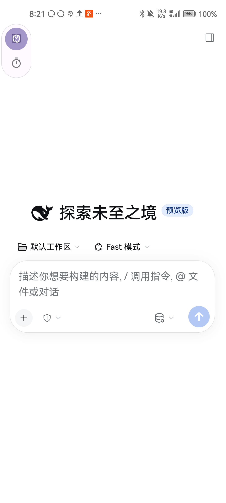
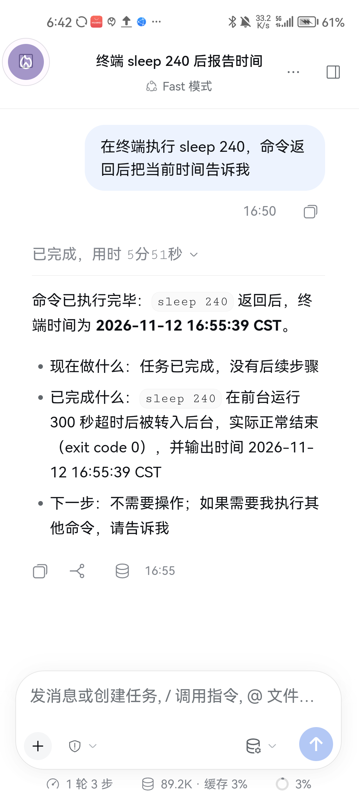

# DSH for Android

<div align="center">

**把完整的 AI 编码 Agent 装进手机。**

跑真 Node、真引擎、真终端——不是套壳聊天框，也不是阉割版界面。

[](LICENSE)
[](#已知边界)
[](#硬约束)
[](#已知边界)
[](#双-web-内核)

[English](README.en.md) · [文档](docs/README.md) · [参与贡献](.github/CONTRIBUTING.md)




<sub>真机截图：官方前端 + 窄屏适配，<code>bash</code> / 终端工具真的在手机上跑。</sub>

</div>

---

## 它是什么

DSH for Android 把桌面端 [DSH](https://github.com/deepseek-ai)（DeepSeek Harness）原样搬进手机：
APK 内置 Termux 环境跑一个 Node，Node 上跑 DSH 引擎，再用 WebView 加载 DSH 自带的 Web GUI。

**它不自绘聊天界面。** UI 完全复用官方前端，窄屏适配由内置插件完成——所以拿到的是**与桌面端
同一个前端**，只是能装进口袋。

| 层 | 里面是什么 |
|---|---|
| 运行时 | Termux bootstrap（bash / dpkg / apt + 64 个 `.so`）、Termux 官方 arm64 node 26.4.0 |
| 引擎 | DSH 引擎 `node_modules` 完整解包到应用私有目录 |
| 原生层 | 自编译的 `require-builtin`、`flock`、`node-pty`，link 与沙箱适配库 |
| 前端 | 官方 Web GUI（`system` 版用系统 WebView，`gecko` 版内置 GeckoView） |
| 插件 | 移动端适配、悬浮球、UI 调试、日志、记忆等内置组件 |

## 亮点

- **Agent 能力不打折** —— `bash`、文件读写、`grep`/`glob`、终端 PTY 全部可用，模型能真的改你的项目。
- **双 Web 内核** —— `system` 版小；`gecko` 版自带 GeckoView，老设备或系统 WebView 被裁的设备也能跑。
  两个包 **applicationId 不同，可同装一台机器**，数据互不干扰。
- **悬浮球** —— 随时唤起，支持自定义外观、帧动画、视频图层。
- **UI 调试工具** —— 模型可以自己看屏幕、点按钮，做端到端自测。
- **救援模式** —— 插件写坏导致打不开？四级降级阶梯 + App 内自助摘除，不会让你彻底失去入口。
- **日志与诊断** —— 三层存储、崩溃现场快照、一键导出诊断包。

## 安装

从 [Releases](../../releases) 下载 APK，侧载安装。

| 包 | applicationId | 适用 |
|---|---|---|
| `DSH<版本>.apk` | `com.dsh.android` | 绝大多数设备，体积小 |
| `DSH<版本>-gecko.apk` | `com.dsh.webview` | 老设备 / 系统 WebView 不可用时 |

> **仅支持 arm64-v8a，`targetSdk = 28`，只能侧载。** 两条都是平台硬约束而不是疏忽，
> 原因见[硬约束](#硬约束)。

## 从源码构建

```bash
bash gradlew :app:assembleSystemDebug --console=plain
bash gradlew :app:assembleGeckoDebug --console=plain
```

PowerShell：

```powershell
$env:JAVA_HOME = "<你的 JDK 17 路径>"

.\gradlew.bat :app:assembleSystemDebug --console=plain   # → app\build\outputs\apk\system\debug\
.\gradlew.bat :app:assembleGeckoDebug --console=plain    # → app\build\outputs\apk\gecko\debug\
```

**环境**：JDK 17 · AGP 8.8.2 · Kotlin 2.0.21 · Gradle 8.13 · compileSdk 35 · minSdk 26

<details>
<summary><b>⚠️ 构建资产需要自备（约 135 MB，不在仓库里）</b></summary>

`app/src/main/assets/` 下的大件资产被 `.gitignore` 排除，**没有它们构建不出可用的 APK**。

| 资产 | 大小 | 来源 |
|---|---|---|
| `engine.bin` | 55 MB | DSH 引擎 `node_modules` 打包 |
| `node-runtime.bin` | 30 MB | Termux 官方 arm64 node |
| `bootstrap-aarch64.zip` | 23 MB | Termux bootstrap |
| `webview-compat.zip` | 9.3 MB | 按 chrome73 降级编译的前端 bundle |
| `pnpm-android-arm64.zip` | 5.6 MB | pnpm 11.28.3 纯 JS 版 |
| `adb-wireless-arm64.zip` | 5.3 MB | Termux 官方 adb |
| `sharp-wasm32.zip` | 3.5 MB | sharp 的 wasm32 变体 |
| `ripgrep-android-arm64.zip` | 2.0 MB | 官方 linux-arm64 静态 rg |
| 其余 26 个 | < 1 MB | 自编译 native 绑定 / 内置插件 zip |

来源、可重建范围与现存输入缺口见[资产重建说明](docs/agents/regen-assets.md)与
[原生来源记录](docs/architecture/native-provenance.md)。`keyinject` 已由 gateway 路径替代并退休。

</details>

## 硬约束

> ⚠️ 这两条是**平台事实**，改动前必读——写错了不会编译报错，但真机必炸。

<details open>
<summary><b>一、包名必须恰好 15 字符</b></summary>

`applicationId` 分别是 `com.dsh.android` 与 `com.dsh.webview`，都是 15 字符。此约束只针对最终
APK 的运行身份；library namespace 与 Kotlin package 可以独立命名。

Termux 官方二进制把 `/data/data/com.termux/files`（27 字节）烤进 ELF 的 `.dynstr`，
而 `TermuxBootstrap.patchElfInPlace()` 只能做**等长原地覆盖**：替换串 `/data/data/<包名>/`
= 12 + N 字节 = 27 ⇒ **N = 15**。

长度不等时该函数**静默 `return 0`**，不抛异常；症状是运行时 `CANNOT LINK EXECUTABLE`
或 `dpkg: Permission denied`。

</details>

<details open>
<summary><b>二、targetSdk 必须 ≤ 28</b></summary>

Android 10（API 29）起，targetSdk ≥ 29 的应用不允许 `execve()` 自身私有目录里的文件
（W^X / SELinux `untrusted_app` 域禁止 `app_data_file` `execute_no_trans`）。而 node / bash / dpkg
全都装在 `filesDir` 下的 `$PREFIX` 里——一升级就全线 `Permission denied`。Termux 官方 App
同样停在 28。**代价**：只能侧载，无法上架 Google Play。

</details>

## 架构

```
MainActivity（WebView / GeckoView）
      │  加载 http://127.0.0.1:<port>
      ▼
  DSH Web GUI  ←── 官方前端 + 移动端适配插件
      │  HTTP
      ▼
  DSH 引擎（Node）
      ├─ tool: bash      → 经 boo-sandbox-run 沙箱
      ├─ tool: read/write → 经 liblinkcompat.so 转译 link
      ├─ tool: grep/glob → 静态 ripgrep
      └─ tool: ui/bubble → 原生桥（文件信箱）
      ▼
  $PREFIX（Termux 环境，filesDir 下）
```

Android 的 `process.platform` 是 `'android'` 而非 `'linux'`，而官方原生插件与平台判断都按
`linux`/`darwin`/`win32` 三选一写；凡是「官方只认 linux、代码本身与 libc 无关」的地方都要补一份
android 实现。link 与沙箱还被内核限制，需要 libc 边界的适配层：

| 层 | 解决什么 | 文档 |
|---|---|---|
| `liblinkcompat.so` | SELinux 不给 `link()` 权限（`EACCES`/`EINVAL`） | [link-compat](docs/agents/link-compat.md) |
| `boo-sandbox-run` + `libboosandbox.so` | Android 没有 bwrap/Landlock，但 `bash` 工具要求沙箱 | [sandbox](docs/agents/sandbox.md) |

## 双 Web 内核

| | `system`（`com.dsh.android`） | `gecko`（`com.dsh.webview`） |
|---|---|---|
| 内核 | 设备自带 WebView | 内置 GeckoView |
| 体积 | 约 114 MB | 约 193 MB |
| 适用 | 新设备、系统 WebView 正常 | 老设备 / WebView 被裁或过旧 |
| 数据 | 独立 | 独立（可与 system 版同时安装） |

## 目录结构

<details>
<summary>展开看模块划分</summary>

```
app/                                  应用装配、Activity/Service、备份与跨领域诊断
core/contracts/ · core/logging/        窄接口、共享模型与日志底座
runtime/termux/ · runtime/engine/      Termux/Node 与引擎生命周期、安装和恢复
platform/privilege/                   Root / Shizuku / ADB
web/contract/ · web/host/              双内核契约与 system/gecko 实现
feature/                              按领域的功能模块（以 settings 注册为准）
native/                               linkcompat、sandbox 规范源码与固定配方入口
plugins/android/bundle/                一个 Android 顶层包
plugins/android/components/            14 个内部组件
plugins/standalone/                    多模态、核心记忆和预设等独立插件
catalogs/                             插件清单、运行资产与来源锁
tooling/plugins/                      统一插件构建实现
tools/                                校验、分层门禁与发布 CLI
remote-plugin/                        reference-only 旧副本与历史测试
docs/architecture/ · docs/runbooks/    工程规范、ADR、状态与操作手册
```

</details>

实际编译模块以 [settings.gradle.kts](settings.gradle.kts) 为准。app 拥有装配、Window 与 Service，
日志底座不反向采集各领域；诊断由 app 组装。工程规则见[规范](docs/architecture/conventions.md)与
[ADR](docs/architecture/adr/README.md)，当前迁移与验证情况见[实施状态](docs/architecture/execution-status.md)。
远程插件正式开发入口是[独立仓库](https://github.com/pht88888888/dsh-jiuling-remote-plugins)，
本仓旧副本仅供参考（差异见[来源审计](docs/architecture/remote-plugin-provenance.md)）。

## 文档

从[文档总索引](docs/README.md)查找架构、手册与历史档案；平台问题按[开发分册](docs/agents/README.md)按需读。

| 你要改什么 | 先看 |
|---|---|
| native / 子进程相关 | [platform-android](docs/agents/platform-android.md) |
| `bash` 工具报 "no sandbox backend" | [sandbox](docs/agents/sandbox.md) |
| `write` 工具报 `EACCES/EINVAL: link` | [link-compat](docs/agents/link-compat.md) |
| 改任何 `.zip` / `.bin` 资产 | [asset-stamps](docs/agents/asset-stamps.md) |
| 构建发行包 / 签名 / 发布 | [build-and-ship](docs/agents/build-and-ship.md) |
| 插件改坏导致 App 打不开 | [rescue-mode](docs/agents/rescue-mode.md) |

## 已知边界

- **沙箱不隔离 PID 命名空间** —— `--unshare-pid` 需要 CAP_SYS_ADMIN，普通应用拿不到；文件写入受
  适配层限制，不等同于内核级隔离（见[沙箱说明](docs/agents/sandbox.md)）。
- **仅 arm64-v8a** —— 没有 arm32 / x86 构建。
- **只能侧载** —— targetSdk 28，上不了 Google Play。
- **包体较大** —— 引擎与 Web 内核随包分发，见上表。
- **首次启动较慢** —— 需解包 Termux 环境与引擎，视设备约 10–60 秒。

完整清单见 [boundaries.md](docs/agents/boundaries.md)。

## 参与贡献

欢迎 Issue 与 PR。动手前请读 [CONTRIBUTING.md](.github/CONTRIBUTING.md)：本项目有几处
**改错不报错、但真机必炸**的陷阱（包名长度、targetSdk、资产版本戳）。

## 致谢

站在这些项目的肩膀上：[DSH / DeepSeek Harness](https://github.com/deepseek-ai)（引擎与前端）、
[Termux](https://github.com/termux)（bootstrap / node / adb）、
[GeckoView](https://wiki.mozilla.org/Mobile/GeckoView)（内置内核）、
[ripgrep](https://github.com/BurntSushi/ripgrep) · [sharp](https://github.com/lovell/sharp) ·
[pnpm](https://github.com/pnpm/pnpm) · [Shizuku](https://github.com/RikkaApps/Shizuku)。

## 许可证

[MIT](LICENSE)
