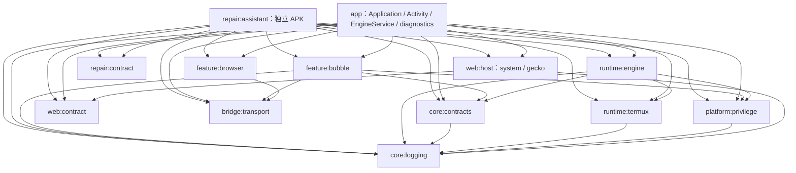

# 当前职责、状态与资源归属

本文记录当前已落盘实现、装配与资源 owner；[批准方案](reorganization-plan.md)保留设计目标，[实施台账](execution-status.md)记录证据与未决项。模块注册、局部编译和分层验收分别记录，不互相替代。当前按[Gradle 注册表](../../settings.gradle.kts)已接入 13 个模块，包含 `:feature:bubble`；悬浮球源码、三份 UI helpers、23 份资源、三份字符串资源及服务声明已迁入该模块。注册和迁移完成不等于独立编译或双 flavor 验收通过。

## 当前物理结构与运行图

图中为已注册模块的直接依赖，见各模块 Gradle 文件。app 显式依赖它直接使用的模块，不用传递依赖掩盖跨域调用。library 使用独立 namespace；保留旧 Kotlin package、Manifest 类名和桥名用于兼容，不据 package 推断物理 owner。WebHost 的两个实现按 flavor 隔离，GeckoView 仅进入 gecko 变体。

| 已注册模块 | 当前职责 |
|---|---|
| `:app` | Application 组装、Activity/Window、EngineService 通知与 WakeLock、Intent/权限 UI、备份导入、跨领域诊断 |
| `:core:contracts` | 共享 EngineStatus、转录与余额等模型、运行路径协议；不拥有 Android 窗口或引擎进程 |
| `:core:logging` | 日志门面、缓冲/轮转、事件、脱敏、崩溃记录与运行身份读口 |
| `:runtime:termux` | prefix 布局、安装锁、bootstrap/Node、ELF 路径重写、apt/mirror |
| `:runtime:engine` | 引擎资产/工具/兼容安装、出厂登记、配置、启动快照与正常进程生命周期 |
| `:platform:privilege` | Root/Shizuku/ADB、无线配对与通知能力 |
| `:web:contract` | WebHost、PageBridge、能力/文件通道与桥协议契约 |
| `:web:host` | system/gecko 宿主、回调、工厂与各自页面实例 |
| `:feature:browser` | AI 浏览器 tab、控制、截图、回调、领域信箱与 owner 世代 |
| `:feature:bubble` | 悬浮球进程策略、窗口/动作/展示 owner、领域命令桥与相关服务/资源 |
| `:bridge:transport` | 完整文件的原子发布，不拥有领域命令、请求 ID 或执行重试 |
| `:repair:contract` | 协议 v4：身份/摘要、grant 续租/撤销、应用级虚拟根文件 Agent 请求及原生变更确认参数；不接收任意绝对根或 shell |
| `:repair:assistant` | 独立 `com.dsh.fixhelp` APK；直接编译原 app 源码、资源和主 Manifest，复用完整 System 宿主、正常启动、全部原版模块及资产，仅追加救援入口、预设、十三工具和授权桥；不依赖目标主 app 的运行状态 |

悬浮球实现由 app 装配并消费 `feature/bubble`；物理迁移保持下表的 process/window/action 分工，不能把状态重新集中到一个类。Bubble 服务声明归 feature Manifest，ShizukuProvider 与 AdbPairingReceiver 声明归 privilege Manifest；权限保护、authority 和 action ID 保持原值。

## 宿主装配与窄 API

主进程 Application 在任何引擎启动前初始化日志、崩溃捕获和待执行数据导入。Activity 拥有 Window、View、ActivityResult 和页面实例；EngineService 拥有前台通知和 WakeLock，Activity 销毁不停止引擎。

| 接缝 | 提供者与消费者 | 当前边界 |
|---|---|---|
| [EngineHostPorts](../../runtime/engine/src/main/java/com/dsh/android/engine/EngineHostPorts.kt) | app → EngineManager | `EngineCommandMailboxes.start(home)` 接领域桥；可选 `EngineLaunchAdditions.prepare(engineDirectory)` 仅向原启动追加 patch/environment，普通双包不注入救援资产。引擎决定调用时机，不 import Service 或具体命令桥 |
| [Application 装配](../../app/src/main/java/com/dsh/android/core/DshApplication.kt) | Application → 各 runtime | `EngineManager.initialize` 注入命令信箱端口与内核身份；配对通知通过 `PairingOperations` 接入，底层不回引 app 实现 |
| [运行身份](../../core/logging/src/main/java/com/dsh/android/log/VersionInfo.kt) | app → 日志底座 | `RuntimeAppInfo` 在 `attachBaseContext` 注入版本、flavor、applicationId；日志不依赖 app BuildConfig |
| [NativePageBridgeDispatcher](../../app/src/main/java/com/dsh/android/ui/NativePageBridgeDispatcher.kt) | MainActivity → 领域提供者 | 通过 [Activity/Bubble/Privilege actions](../../app/src/main/java/com/dsh/android/ui/NativePageBridgeActions.kt)分派既有 47 方法。dispatcher 不拥有配置、队列或 Window；窗口和系统 Intent 留在 Activity |
| BubblePanelActions / BubbleStatusSource | Activity、Service 状态读口 → BubbleController | Activity 强持动作端口，controller 弱持端口及 owner；旧 owner detach 不撤销新端口。状态源仅在 attach 读一次，不长期保存 Activity 回调 |
| [BrowserOwnerRegistry](../../feature/browser/src/main/java/com/dsh/android/browser/BrowserOwnerRegistry.kt) | 页面宿主 → 浏览器桥 | owner 与 generation 共同界定绑定；替换 owner 失效旧等待者，旧 detach 不清新宿主 |

日志底座位于 `core/logging`；`DiagnosticBundle`、`EnvironmentSnapshot`、`LogUploader` 在 app 的 diagnostics 源目录组装跨领域快照、脱敏包和上传，保留历史 Kotlin package。日志写入不能反向采集 EngineManager、Activity 或 Service 全部状态。

目标 app 的 Provider、维护授权页和单文件变更确认页位于 `:repair`，其 Application 分支跳过日志、导入、Termux 与引擎初始化；进程名无法确认时不引导。grant 绑定启动次数、双方安装身份和 30 分钟空闲期限，持久化在 `:repair` 专用偏好设置；助手的前台通知会话只因真实用户/Agent 活动续租，定时器本身不续租。Provider 每次重查签名、UID、包归属和 grant。

助手 `0.5.0` 完整复用原版 DSH 的源码、资源、模块、插件与正常启动，只追加 [救援 patch](<../../repair/assistant/src/main/assets/repair-agent/repair.patch.yml>)、设置入口和工具；不再有 repair-only 工具表、三 namespace 设置编辑器或禁用原 Host/Client 的 hardening 层。原版模型设置、shell/文件/插件工具及用户授予的 Root/Shizuku/ADB 能力保留。独立 UID 和私有 HOME/DSH_HOME 隔离数据，不自动导入原目标模型密钥；救援授权扩大到应用文件后，可按需经目标 broker 读取配置，必须避免无关秘密外发。**不能将新增 broker 的范围限制宣称为整个 Agent 的强制沙箱**：用户额外授予的原版特权能力可能绕过 broker；普通 UID 的跨包私有文件访问则仍经目标身份、grant 和确认检查。同 UID 通用工具可检查私有信箱并仿造请求；每 Agent/epoch 绑定防无意的旧请求跨目标，不宣称可隔离恶意同 UID 代码。

新增 broker 读取脱敏当前启动证据，通过平台 Context 提供的 `app/device_app/external_files/external_cache/external_media` 等虚拟根访问原应用自身文件。支持分页列举、UTF-8/base64 片段、流式全摘要/备份和大文件字节补丁，以及新建/删除文件或空目录候选；不再按单包/扩展名白名单筛选。128 KiB 是单次内容传输上限，不是文件总大小限制。仅精确保护救援授权、排他锁和事务存储；拒绝链接/硬链接及 OS 不可访问对象，系统安装区用签名更新。提交/回退需有效本任务授权，敏感候选另需绑定摘要与版本的一次性原生确认，并要求引擎排他及目标主进程退出；同 UID `/proc` 发现 Node/engine 命令行或状态不明则拒绝。正常锁覆盖整个 start 与 Node `waitFor`。原生确认可请求窄范围 SIGTERM 已核验同 UID/exe/argv/PID/启动身份的精确目标进程，提示请求、终端、未保存内容中断；不 forceStop/SIGKILL，不碰无关 Node，失败不提交。单文件 journal 按 grant 隔离，新 grant 不自动开放旧备份；profile/插件/私有 native/lib/二进制/用户数据在统一范围内，但字节事务不保证数据库语义、运行代码安全或多文件原子性。0.4.0用户实测读正常但全部stage失败；0.4.1用fstatvfs检查已持有目录FD、把拒绝hardlink后的排他预约兼容扩展至私有根，并提供固定阶段/操作/errno诊断与目标file_broker_revision；只证明主机模拟拒绝下修正通过，不把推测SELinux原因当设备结论。完整 Web smoke、最终源码门禁和设备证据分别记录，旧裁剪版通过报告不能证明本轮可用；见[实现与验收边界](<../agents/repair-assistant.md>)。

## 状态、资源与释放

| 状态或资源 | 唯一 owner | 生命周期、释放与失败语义 |
|---|---|---|
| Node 主进程、userStopped、运行状态 | EngineManager | 引擎运行世代；退出/重启核对当前进程身份，安装组件不接管起停策略 |
| 助手 Node、官方 Web、救援信箱 | 原版 EngineManager / MainActivity / RepairHostController / RepairAgentBridge | 原版 owner 继续控制引擎和页面；救援 controller 只拥有目标授权与桥，断开不终止普通聊天。绑定 epoch 与每 Agent 绑定阻止旧请求跨目标。旧裁剪 runtime/launcher 在 legacy-retired，不编译 |
| 维修租约活动标记、前台通知 | RepairSessionService；目标 RepairAuthorization 校验 grant | 非 sticky 用户会话；真实交互或 Agent 事件才产生续租依据，通知停止或空闲超时不能靠定时器复活 |
| 目标启动闸、任务、operation、attempt、内部执行许可 | RepairTaskCoordinator / RepairTaskService / RepairRuntimeGate / RepairValidationService | 持久闸门不是授权；内存 permit 绑定主 PID/starttime/task/attempt/kind/deadline。后台真实引擎检查与用户前台 UI-ready/首帧验证分开，失效先清权限再异步停机/恢复，unknown writer或未决journal保留恢复闸；后台日志独立正常启动统计 |
| 维修候选、原件、journal、确认 token | 目标 RepairFileBroker / RepairChangeApproval | 按 grant 分区的流式单路径事务（内容片段128 KiB，非整文件限制）；确认一次消费，apply/rollback 需排他和主进程/同 UID Node 静止检查，未知状态拒绝，摘要不符报告冲突；跨新 grant 备份恢复尚未开放 |
| 通知、WakeLock | app EngineService | Service 生命周期，UI 重建不转移资源 |
| prefix 安装锁、归档/Node 安装事务 | TermuxBootstrap 与安装组件 | 进程锁/文件锁；事务 finally 释放，路径重写不创建新用户根目录 |
| Root/Shizuku/ADB 会话与配对 | privilege 领域组件 | 进程级连接；失败/停止关闭，不跟随 Activity 重建 |
| 主聊天 WebHost/View | MainActivity 与单个宿主实例 | Activity 负责装卸，宿主 destroy 是终态；渲染进程退出后仅手动重建 |
| 权限与文件选择 pending | RuntimePermissionQueue / 对应宿主请求 owner | 成功、拒绝、取消、失败和 destroy 恰好一次结算；旧 owner 不消费新 pending |
| 页面标注状态与 ack | BrowserPaneCoordinator / 单 WebHost 协议实例 | annotationId/requestId 与画布世代配对；只有匹配 ack 清除，重试不能先消费 |
| 下载连接、流、`.part`、目标文件 | SessionDownloadService 单次事务 | 唯一临时文件、原子提交；取消需中断阻塞 IO、关闭流和连接，失败清理私有临时文件；并发与慢 HTTP 收口尚待最终证据 |
| 启动覆盖层、首帧等待、IME、退回、闪烁 | app 对应 UI 组件 | Activity 持组件，各自取消自己的等待、计时/动画与 View 引用，不能接管引擎状态 |
| 浏览器 tabs/WebViews | BrowserTabSessionStore 与 AiBrowserView | 关闭只结算本 tab 等待者；destroy 结算全部，核对 owner 世代 |
| 浏览器控制/截图/回调 | BrowserControlSession / BrowserCaptureService / BrowserWebCallbacks | timeout、Bitmap、订阅由单任务 owner 清理，过期 tab 回调不能写新页面 |
| Browser command claim / 回执 | BrowserCommandMailbox | 领域独占领件槽、最近 ID、journal、重启恢复与结果；细节见下文 |
| 通用文件原子发布 | AtomicMailboxFiles | 写唯一同目录临时文件、flush/fsync、原子替换、finally 清理；不退化为半写目标 |
| 备份导入替换事务 | UserDataImporter + Application 启动入口 | staged 导入，原目录备份，失败恢复；不要求引擎健康，不默认清数据 |

悬浮球内部 owner 已按职责分开，并迁入 `feature/bubble`：

| owner | 独占状态与资源 | 边界 |
|---|---|---|
| BubbleController（进程） | enabled/foreground/overlayProbe、最新状态/转录/余额三槽、唯一原子点击计数、弱动作端口 | 各快照整份替换，false/空字段也生效；hide 只销窗口，不清进程快照 |
| FloatingBubble（窗口） | WindowManager、主球/展开/贴边/状态/余额窗口、坐标/焦点/手势、walk 动画、传感器/IME/配置监听 | 首次绘制前 configure 但不启动计时；addView 成功后再 start；hide 或挂载失败释放窗口与组件绑定 |
| BubbleActionController（动作） | runState、动作优先级、manual TTL、链/重复游标/turn 标记、展示抽样缓存、chain/move/manual 三类任务 | 仅接 Assets 读口、状态谓词和动作/展示/走动事件；release 失活并取消任务，旧回调不续排 |
| renderer / animator / frame player | 转录 dirty/行缓存/滚动任务；旋转/pulse/挤压；帧游标/循环任务 | detach/release/stop 按 owner 取消任务、断 View 引用，帧回调校验世代 |
| motion / status / balance / appearance | 纯物理状态、内容去重/TTL、余额显示模型、解析/持久化/几何计算 | 计算和缓存不持有 Activity，TTL 与展示资源由创建方清理 |

### Browser 文件事务

[BrowserCommandMailbox](../../feature/browser/src/main/java/com/dsh/android/browser/BrowserCommandMailbox.kt)保留 Node 侧 `browser-cmd.json` / `browser-result.json` 契约。请求原子移到领域 processing 槽后执行，结果先存内存、落 receipt，再原子发布；只删除匹配本次领件，不删除后来到达的 command。发布失败保留已执行结果，下一轮只重发，不重跑网页动作。重启时，有回执重发，无回执交上层明确报告中断；最近已完成 ID 用于重复投递去重，不宣称跨崩溃无限历史 exactly-once。

[AtomicMailboxFiles](../../bridge/transport/src/main/java/com/dsh/android/bridge/transport/AtomicMailboxFiles.kt)只复用发布机械过程。bubble、logs、statusbar、ui 等仍各有信箱、命令 ABI 与领域状态，没有统一大 worker 接管所有领域。

## 用户路径与外部契约

[RuntimePaths](../../core/contracts/src/main/java/com/dsh/android/runtime/RuntimePaths.kt)当前集中声明 `DSH_HOME_REL = home/.dsh`；其余路径仍由各 owner 使用，不能把此类描述成已统一管理所有路径。迁移源码不迁移用户目录：

| 相对 filesDir 路径 | 用途 |
|---|---|
| `termux/usr/` | Termux prefix、Node、pnpm、原生依赖 |
| `termux/home/` | Termux shell home |
| `engine/` | APK 引擎解包与平台兼容产物 |
| `home/`、`home/.dsh/` | 引擎 HOME；用户配置、凭据、会话、插件与 profiles |
| `workspace/`、`logs/` | 用户工作区；日志、崩溃与导出 |

两个最终 applicationId 仍为 `com.dsh.android` / `com.dsh.webview`（15 字符），targetSdk 28，正式签名不变。桥保持 `window.DSHAndroid` 47 方法、BridgeProtocol v1、`dsh:bridge-result`，标注 ack 与 Gecko 隔离世界 JSON 消息不变。备份继续校验 ZIP 路径、附件关联及凭据显式选择；出厂包不复活用户禁用/卸载状态，profile registry 版本优先。

## 插件、脚本与原生源码

[唯一组件 catalog](../../catalogs/plugin-components.json)共 18 项：Android bundle + 14 内部组件 + 3 standalone；用户顶层为 4 包，Android 顶层仍只有一个。规范源码是 `plugins/android/bundle`、`plugins/android/components` 与 `plugins/standalone`，[tooling 构建器](../../tooling/plugins/build.mjs)生成 ZIP、manifest 与 generated assets；旧 tools 命令是兼容入口。Gradle 消费生成产物，不回写手写源码目录。旧远程副本仅 reference-only，保留 pair-server/历史测试；生产来源和差异见[远程来源审计](remote-plugin-provenance.md)。

四份手写运行脚本在 `runtime/scripts`，WebView polyfill 在 `runtime/webview`，桥协议在 `contracts/bridge`；`stageAndroidAssets` 暂存并将 `protocol.json` 输出为 `bridge-protocol.json`，APK 资产名和设备落盘名不变，映射见[资产重建](../agents/regen-assets.md)。

native 可维护源码只有 `native/linkcompat/linkcompat.c`、`native/sandbox/boosandbox.c`、`native/sandbox/boo-sandbox-run.c`；旧 jni 副本已移除，[唯一 runner](../../native/build.mjs)只消费三份规范源码与固定配方。来源锁区分当前字节与完整可重建输入；仍有 9 类外部缺口，keyinject 已退休，不计 active 缺源，见[原生来源记录](native-provenance.md)。

## 回退与故障恢复边界

| 变更或故障 | 回退单元与负责人 | 约束 |
|---|---|---|
| 物理模块接入失败 | 主集成成组回退该模块的注册、依赖、源码位置和调用接线 | 不只改 settings 掩盖双份源码；不覆盖用户已有未提交变更；保持包名、身份与用户路径 |
| 插件/脚本打包漂移 | catalog + 规范源码 + 构建器 + Gradle staging 同一变更单元 | 以摘要定位旧输入和产物；不复制生成文件成为第二份源码，不动用户 registry/禁用状态 |
| 引擎启动失败 | EngineManager | 保留错误与诊断证据，释放失败进程；手动重试，不清空 DSH_HOME |
| UI/浏览器旧回调 | 对应 owner 的 detach/destroy/取消通道 | 保留新 owner 与新请求；结果发布失败按领域事务恢复，不能删除后来请求 |
| 备份导入失败 | UserDataImporter staged 事务 | 使用原目录备份恢复，不卸载应用、不改签名 |
| 发布候选不完整 | 显式发布 CLI 与候选记录 | 拒绝 prepare/promote；历史 APK 不自动绑定新源码，不默认上传；见[发布手册](../runbooks/release.md) |

结构回退由主集成按原子变更单元执行，不在本文承诺自动回滚命令。实施结构与 owner 已落地；全链路验收以本轮生成的 `build/verification/final-acceptance.json` 及其引用的分层报告、原始证据为准。局部 fixture、首次编译或历史 APK 检查都不代表 L0–L3 整体验收，实际输入与报告规则见[测试手册](../runbooks/testing.md)。本文随 sourceSnapshot 冻结；source-record 后验收结果写入忽略的 build 输出或仓库外临时目录，不为回填结果修改已绑定源码。
