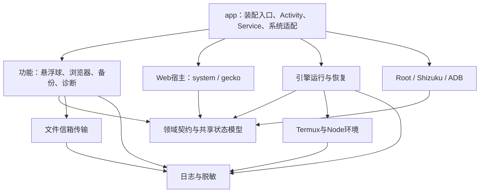

# DSH Android 全项目架构重组与工程规范方案

> 状态：完整设计方案，供分阶段实施与验收。
> 代码基线：运行依赖首次拆分后，EngineManager 6,965 行、MainActivity 5,469 行、FloatingBubble 5,426 行。
> 本文中的新模块、目录、门禁和阶段交付均为目标设计，不代表已经完成迁移。

## 1. 目标与验收原则

将项目从“按目录分类、由几个大类协调全部功能”，演进为“职责和状态有明确归属、依赖方向受约束、构建可追溯、关键行为有自动验收”的工程。

覆盖范围：Android Kotlin、Web 内核与原生桥、JS 插件、Termux/Node/原生资产、构建工具、测试、CI、发布及文档。远程插件独立仓库纳入版本与兼容契约治理，不在 Android 仓库继续维护其生产源码双副本。

“企业级”以以下工程结果衡量，不对应某项认证：

1. 每项可变状态、后台任务、连接和系统资源都有唯一所有者，以及创建、取消、释放路径。
2. 模块依赖无环，底层不依赖 Activity、业务界面或应用装配实现。
3. 新功能有明确落点，不能继续向历史大类增加完整业务实现。
4. 干净检出能够运行基础检查；真实引擎、大资产和设备验证显式声明输入。
5. 发布产物可追溯到源码、依赖、资产、工具链和验证报告。
6. 会话、附件、凭据、工作区及用户插件状态在迁移中得到保全。

执行路线：**基线与契约 → 职责拆分 → 依赖反转 → 物理模块化 → 插件与资产重组 → 工程门禁收口。** 每批变更独立审阅、验收和回退。

## 2. 现状诊断

| 现状 | 维护影响 | 改进方向 |
|---|---|---|
| [settings.gradle.kts](../../settings.gradle.kts) 仅包含 :app | 包目录不能阻止跨层引用 | 先形成逻辑边界，再提取编译边界 |
| 引擎、主界面、悬浮球仍各有五千行以上代码 | 小改动需要理解大量共享状态 | 拆完整职责和资源所有权 |
| 引擎启动具体命令桥、读取通知状态；配对通知又调用引擎 | 引擎、宿主与特权难以独立演进 | 由 app 装配窄能力接口 |
| 日志、诊断采集与界面互相引用 | 底层日志反向依赖业务 | 分离日志底座与跨域诊断组装 |
| 移动布局 JS 约 4,990 行，设置 JS 约 3,751 行 | 前端同样容易继续堆积 | 按功能拆入口、状态、UI、服务和清理 |
| 默认 CI 声称无需引擎，市场测试却立即读取引擎归档与全局安装 | 干净 CI 缺输入 | 分离纯行为与真实官方契约验证 |
| 发布脚本仍检查旧插件资产、使用旧分发目录 | 验错对象或误报整体成功 | 分步发布、双包核对、明确部分失败 |
| App 内旧远程插件副本落后于独立发布版本 | 双来源与旧代码回退风险 | 发布包完整性基线、旧副本退出生产链 |
| 部分 native 源码和生成配方外置或缺失 | 全量可重建性不足 | 资产锁、来源缺口与配方归档 |

已有统一插件构建器、双内核桥协议测试、补丁注册表和架构守卫继续使用。方案不要求更换现有技术栈。

## 3. 必须保留的约束

- 继续复用官方 Web GUI，移动端通过官方插件接缝适配。
- 保留 system/gecko 两种 flavor；独立 AI 浏览器继续使用自己的 WebView 会话。
- 两个运行包名、正式签名、运行数据目录保持稳定。运行包名继续满足 ELF 等长替换的 15 字符要求，targetSdk 保持 28；library namespace 不套用运行包名的长度约束。
- 用户顶层仍看到一个 Android bundle，内部展示现有 14 个组件。核心记忆、预设等独立包保留独立身份。
- 离线出厂可用、registry 版本优先、禁用/卸载不复活、官方安装更新事务与 HMR 均保持。
- 一批结构迁移不同时改变协议、用户存储格式和业务失败策略。行为调整另行提交。

平台与产品规则以 [AGENTS.md](../../AGENTS.md) 和[内置插件与市场更新](../agents/plugin-updates.md)为依据。历史文档与当前规则冲突时，在对应阶段修订并归档历史说明。

## 4. 目标架构

### 4.1 分层与依赖



箭头表示允许的代码依赖。跨功能协调由 app 接线，功能间通过所属领域的窄接口通信。

### 4.2 物理模块目标

| 模块 | 内容 | 禁止的依赖 |
|---|---|---|
| `:app` | Application、MainActivity、EngineService、Manifest、最终资源、系统 Intent、通知和依赖装配 | 不承担底层安装、渲染和数据事务实现 |
| `:core:contracts` | 按 engine、privilege、transcript 等领域分包的少量共享模型和接口 | Android View、功能实现、全局可变服务定位 |
| `:core:logging` | 日志写入、轮转、基础事件、脱敏 | 引擎和界面快照的主动采集 |
| `:runtime:termux` | bootstrap、Node、ELF 重写、apt 配置、prefix 安装锁 | engine、app、功能 UI |
| `:runtime:engine` | 安装装配、启动配置、进程、探测、健康和恢复 | Activity、通知 Service、具体领域命令桥 |
| `:platform:privilege` | Root/Shizuku/ADB 连接、执行、配对 | engine 实现、MainActivity |
| `:web:contract` | WebHost、PageBridge、权限/文件/下载通道、桥协议 | 功能实现和具体宿主 |
| `:web:host` | system/gecko 源集与工厂；仅 gecko 变体依赖 GeckoView | 功能实现；Gecko 依赖泄漏到 system |
| `:feature:bubble` | 窗口、渲染、动画、运动、展示与本领域命令 | MainActivity、EngineManager 实现 |
| `:feature:browser` | 标签、控制权、截图、浏览器适配与本领域命令 | MainActivity、bubble 实现 |
| `:bridge:transport` | 经测试证实相同的轮询、原子发布、配对和关闭语义 | 具体领域执行器 |

备份、诊断和启动界面先保持 app 内的独立功能包。出现明确的独立构建、依赖隔离或复用需求后再提物理模块。

契约优先放在所属领域。core:contracts 不是所有对象的集中仓库；新接口必须列出提供者和消费者。共享 transport 也在协议差异查清之后提取，不能先建万能命令总线。

### 4.3 装配规则

- app 通过构造注入和现有工厂组装组件，不默认引入 Hilt。
- 组件只接收需要的路径、能力、状态源和回调，不接收整个 AppGraph 或万能宿主对象。
- EngineService 留在 app，拥有前台服务、通知和 WakeLock；引擎通过只读活动状态接口获得忙闲信息。
- 日志底座负责写入。诊断组装器注入各领域快照提供者，不让日志模块反向抓取所有模块。
- app 的 BuildConfig、R、Activity 和 Service 不成为底层模块的依赖；需要的运行身份或资源通过明确参数传入。

## 5. Kotlin 责任拆分清单

### 5.1 EngineManager

| 目标组件 | 拥有的工作与资源 | 管理器保留的决定 |
|---|---|---|
| EngineRuntimeDependencies，已完成 | 7 项运行依赖安装、安装判断和资源处理 | 调用时机与顺序 |
| EngineAssetInstaller | 解包、校验、版本戳、临时目录 | 何时安装或重解包 |
| EngineCompatibilityInstaller | Web 兼容资产、guard 和平台适配库落盘 | 顺序与失败后的启动策略 |
| ProfileOverlayWriter | 基于明确输入生成 overlay | profile 选择与应用顺序 |
| ProfileDefaultsInstaller | 首次默认值和明确缺项初始化 | 是否允许初始化；用户设置不可覆盖 |
| EngineLaunchSpecBuilder | 不可变 argv/env/cwd/profile/端口/overlay 列表 | 本轮真实启动快照 |
| EngineProbeRunner | 临时探测进程、输出上限、超时和 finally 清理 | 救援、隔离和真实启动决策 |
| PluginIsolationTransaction | 临时清单、备份、完整恢复、隔离计算与报告 | 救援等级和最终隔离决定 |
| EngineMemoryMonitor | 当前进程世代采样、阈值计时和建议事件 | 核对进程身份后决定重启 |

EngineManager 始终拥有真实子进程、用户停止意图、State/UiStage、启动顺序、重启与降级决策。不能拆出第二个与它竞争状态的 manager。

真实启动、配置解析和启动探测复用同一份 LaunchSpec，按模式显式描述差异。敏感 env 不进入普通日志。静态配置通过、进程就绪、页面首帧和插件激活是不同事实。

EngineFilePatches 继续维护锚点及应用体，管理器保留顺序与结果决策。补丁失配、非致命安装失败等现有策略在结构迁移时保持；改善策略需要独立变更。

### 5.2 MainActivity

| 目标组件 | 独立拥有的内容 |
|---|---|
| SessionDownloadService | 连接/流、命名、临时文件、完整提交、失败取消清理 |
| RuntimePermissionQueue | 合批、串行队列、在途请求、恰好一次派发 |
| SystemBarFlashSequence | 帧序列、循环次数、配置快照、定时器 |
| WebRecoveryController | 世代、退避、重试、新首帧等待 |
| BootOverlayPresenter | 启动层展示状态、错误分类和启动世代 |
| ImeLayoutController | 键盘预判、尺寸策略、缓存 |
| BrowserPaneCoordinator | 面板会话、嵌入/静默、待发送标注及身份 |
| NativePageBridgeDispatcher | 保持外部签名，向领域能力委派 |

Activity 保留 Window、Binding、生命周期、ActivityResult 注册、系统 Intent、View 挂载和最终销毁。

关键不变量：

- system 下载保留 Cookie/User-Agent/Referer；Gecko 消费已授权响应流，不重新发起 HTTP 下载。
- ActivityResultLauncher 仍由 Activity 注册，队列只拥有排队和结算状态。
- 文件选择、权限申请在成功、拒绝、取消、失败、销毁时都结算。
- Activity 销毁不停止进程级引擎。
- 恢复使用正确的原始授权 URL，并等待本次 reload 的新首帧。

### 5.3 FloatingBubble

- BubbleTranscriptRenderer：消息行、角色复用缓存、dirty 状态、贴底和内容尺寸。
- BubbleAnimationController：动作优先级、帧/链游标与自身定时器，复用已有视频层。
- BubbleMotionController：手势采样、速度和飞行状态，复用已有物理计算。
- BubbleStatusPresenter / BubbleBalancePresenter：各自的展示、文案、去重和超时。
- BubbleController：进程级启用策略与最新快照，不长期持有 Activity 回调。

原类逐步收敛成 BubbleWindowHost，拥有 WindowManager、真实坐标、LayoutParams、焦点、展开状态和挂载/释放顺序。运动组件输出期望位置，不维护第二套实际坐标。hide/detach 对称关闭动画、视频、传感器、post 任务和宿主绑定。

### 5.4 AiBrowserView

- BrowserTabSessionStore：标签会话、WebView、标题、等待者和选择索引。
- BrowserCaptureService：单次截图、Bitmap、超时、回调和临时文件。
- BrowserControlSession：USER/AI 控制权、静默输入和工具调用状态。
- BrowserChromePresenter：工具栏、胶囊提示和布局展示。
- BrowserWebCallbacks / BrowserDownloadAdapter：每个会话的内核与下载适配。

View 保留视图树、布局与宿主接缝。关闭标签只结算该标签等待者；异步截图核对标签/宿主世代；销毁释放全部资源。主聊天 Web 会话与 AI 浏览器会话保持各自职责。

### 5.5 其他大文件

- EngineConstants：运行版本/安装元数据、补丁字面量、prompt 模板、默认配置分别归属对应职责，禁止形成新的巨型常量仓库。
- TermuxBootstrap：提取归档安装、Node 安装修复、ELF 重写、镜像与 apt 配置；prefix 锁和装配顺序保持唯一所有者，复用已有 MirrorProbe、AtomicTextFile 等组件。
- BubbleAppearance：分离外观数据、解析校验、持久化和尺寸计算，保持现有字段、默认值、存储键与兼容读取。

## 6. 协议、状态与生命周期标准

### 6.1 通信与 ABI

两条通信链：页面插件 → Web 适配 → PageBridge → 领域组件；Node 工具 → 独立领域信箱 → transport → 领域执行器 → 结果。

- 保留 window.DSHAndroid 的方法名、参数、返回类型、事件名和 JSON 文本语义。
- 保留 system 同步调用与 Gecko 异步消息/同步快照的区别。
- 将现有方法/能力清单归入 contracts/bridge；Kotlin 接口保留类型约束，CI 对照两个内核与 JS。避免增加第二份手写白名单。
- 新能力向后兼容扩展，本轮不整体替换旧协议。
- 标注 requestId 重试不消费，身份匹配 ack 才消费；pending 属于单个 WebHost。
- 信箱保持领域隔离、请求配对、先结果后删请求、原子发布及损坏请求处理。
- 本次不改变用户配置、备份包和会话格式。新增构建清单使用 schemaVersion。

### 6.2 三类作用域

| 作用域 | 典型所有者 | 结束条件 |
|---|---|---|
| 应用进程 | 引擎服务、信箱 worker、特权连接 | 显式停止或进程结束 |
| 引擎运行世代 | 真实进程、内存采样、本轮启动快照 | 进程停止/替换 |
| Activity/WebHost 实例 | View、权限队列、浏览器面板、标注 pending | detach/destroy |

每个协程、线程、Handler、监听器、流、Bitmap、连接和等待回调必须归属其中之一。跨作用域返回检查 owner/generation。取消必须传播，不能被宽泛异常捕获吞掉。UI 在主线程；文件和阻塞工作使用明确后台执行器。

状态读取不触发授权，执行/配对通过显式命令发起。外部输入先校验再执行，日志保留结构化错误原因并脱敏。

## 7. 插件、资产与目录治理

### 7.1 目标源码结构

```text
app/                         应用装配、系统入口与轻量功能包
core/                        契约、日志
runtime/termux/              Termux/Node
runtime/engine/              引擎运行
runtime/scripts/             手写运行脚本与 guard
runtime/webview/             官方前端兼容输入和 polyfill
platform/privilege/          特权
web/contract/                Web/桥接口
web/host/                    双内核
feature/bubble/              悬浮球
feature/browser/             AI 浏览器
bridge/transport/            已验证可复用的文件信箱
plugins/android/bundle/      Android 聚合包
plugins/android/components/  14 个内部组件
plugins/standalone/          独立插件
native/                     可追溯 C 源码与构建配方
catalogs/                   插件清单、运行资产锁、外部版本锁
contracts/                  跨语言协议和官方契约样本
tooling/                    按 plugins/runtime/native/device/release 分类
docs/architecture/          架构、依赖、ADR
docs/runbooks/              当前执行手册
docs/history/               过期历史说明
```

目录逐类迁移，先稳定输入输出契约。插件包名、ID、ModuleLoader ID、配置键与运行路径不随源码目录变化。旧入口仅在仍有消费者时短期转调，并记录删除条件。

### 7.2 JS 拆分

顺序：设置插件 → 移动布局 → 悬浮球 Host → 市场实现。

每个组件分入口、状态、UI/DOM、服务交互、样式与契约。apply 负责装配并返回完整 dispose；功能自行释放 observer、timer、listener、请求。模块顶层不启动永久副作用。

扩展已有 esbuild 合并本组件的本地源码模块，最终仍输出官方 ModuleLoader.load/factory(require)/apply/dispose 形式。官方动态 require 留在运行时，React 保持延迟获取，不打包第二份 React/官方客户端。Chrome 73 目标不变。Node Host 保留原生 ESM，不默认全量改 TypeScript。

### 7.3 单一事实源

- 插件清单：成员、源码、入口和打包关系。
- package 元数据：包名、版本、exports、dsh 字段。
- 构建器：交叉校验并生成聚合 patch、资产映射、逐文件摘要和 manifest。
- 运行资产锁：engine/Node/pnpm/bootstrap/native 的来源、版本、摘要、ABI、工具链、配方和许可证。
- 兼容包：只处理官方引擎/前端，不包含覆盖业务插件的副本。
- release manifest：引用上述清单和锁的摘要，不维护另一套人工版本表。

Gradle 逐步消费 generated assets，退出构建回写源码资产和共享软链目标的模式。先迁移全部读取者，再切换资产源并逐文件比对。

确定性 ZIP 和内容可重建性分别验收；不预先承诺签名 APK 在不同环境下逐字节一致。

### 7.4 远程插件和不可重建资产

远程插件当前核对的 npm 版本为 mobile 1.2.105、desktop 1.0.56；执行时重新固定 version/integrity/gitHead/tarball，并核对与候选源码的差异。同版本号不代表源码等于线上发布包。

先审查旧 App 副本特有变更、pair-server、部署和测试引用，再退出生产链。App 只保留外部仓库指向与兼容契约。独立仓库改动另立任务，不直接把旧副本覆盖到最新版。

部分 native 配方外置，先记录现有制品来源、摘要和缺口；源码/配方补齐前不能宣称全量从源码重建，也不擅自替换现有发行能力。缺口只阻断相应“全量可重建”验收，不阻断其他拆分。

事实更正：方案基线调查时曾记“未找到 keyinject 对应源文件”；后续已确认 keyinject 已由 gateway 路径替代并退休，当前安装器只清理历史库，不是 active APK 资产，也不列为待补源码的发行能力。该更正保留原调查语境，不代表其余全量重建目标已完成；现行来源缺口见[原生来源记录](native-provenance.md)。

## 8. 编码、评审与工程规范

### 8.1 代码约束

- 一个组件对应完整职责；内部默认最小可见性，公共 API 明确消费者。
- 禁止通过整个 Activity/AppGraph 或大量可变回调间接共享状态。
- 500–800 行触发职责复审；新增手写文件原则上不超过 1,000 行，例外说明原因。历史大文件只降不升，禁止为行数机械搬成员。
- 三个宿主以约 1,000 行以内为整理目标，验收以职责、状态与生命周期为准。
- Kotlin 沿用官方风格，JS/C 保持项目约定。固定静态分析工具版本和历史基线，禁止新增问题，逐步消减存量；不夹带全仓格式化。
- 业务失败使用明确结果；异常边界保留原始原因。结构迁移不改变降级策略。
- 注释解释平台约束和设计原因；历史排障经过迁到文档，不继续堆入构建脚本。
- 协议、持久化键、用户数据与签名变化必须单独列出兼容和回退策略。

### 8.2 变更单元

每个变更说明问题、目标职责、状态/资源所有者、输入输出、公共行为影响、验证结果和回退点。职责提取、行为修复、目录移动分别成批；同批只迁一组相互关联的状态。重构期间新功能进入目标组件。

常规修复使用最小变更；跨层依赖、协议、运行资产和发布机制调整通过 ADR 记录决定。评审检查“状态归谁、资源谁释放、错误如何传递、消费者是否兼容”，不能只检查文件是否变短。

## 9. 测试与 CI 分层

| 层级 | 输入/触发 | 覆盖 |
|---|---|---|
| L0 基础 PR | 无引擎及 Android 大资产的干净检出 | 依赖边界、双内核协议、插件清单、JS 行为/dispose、真实 npm pack、确定性插件构建、文档和敏感文件 |
| L1 真实引擎 | 引擎/补丁/兼容/更新安装变更及发布前 | 锁定引擎、真实 Kotlin 补丁、锚点失配/幂等、官方模板/RPC、更新事务和配置恢复 |
| L2 Android | Android 变更在具备输入的构建环境执行；发布强制 | Kotlin 单测、lint、双 flavor 构建、DEX、ZIP/manifest、包名/targetSdk、签名和版本 |
| L3 设备 | 平台/生命周期/数据迁移变更及发布 | 冷启动、保活、双内核授权、恢复、气泡/浏览器释放、升级与市场状态保全 |

市场测试分纯行为和官方契约两层。基础层使用带版本、来源和摘要的小型官方契约样本，真实层阻断样本漂移。不能删除真实覆盖，也不能将缺输入后的 skip 算作通过。

Android 状态和文件事务使用 JUnit、协程虚拟时间测试；JS 沿用 node:test。现有以 Node 驱动真实 Kotlin 的注册表测试可保留，移除机器绝对路径及全局安装依赖。

重点测试：

- 下载净化、完整提交、失败取消清理与两种授权输入。
- 权限合批、串行、派发重入、销毁恰好一次结算。
- Flash stop/静态恢复、转录角色复用与贴底。
- LaunchSpec 一致性、overlay 顺序、探测超时清进程。
- 隔离事务异常后逐字节恢复，静态解析不能冒充真实 Ready。
- 旧进程/旧宿主回调不能覆盖新世代。
- 标签关闭结算本标签等待者，截图取消释放 Bitmap/文件回调。
- 信箱错配、重复重试、原子结果及 UI 解绑。

每次验证记录实际用例数、跳过数和输入。保持项目架构检查和双 flavor 构建，只运行与本批风险对应的设备场景。外观和交互手感用明确步骤交人工验收。

## 10. 发布、可追溯与安全

发布分 prepare → check → publish → promote → archive：

1. prepare：固定源码、依赖、资产和工具链，构建候选包。
2. check：核对两个 APK 的身份、版本、签名、资产和门禁报告。
3. publish：上传两个候选包并确认完整落地。
4. promote：两包齐备后提升到 `jiulingShare/DSH APP/当前最新版`。
5. archive：被替代的两包归入 `历史版本` 并回查。归档或上传部分失败保留可恢复状态，不误报整体成功。

不可变 release manifest 包含：源码 commit/工作区状态、两 flavor 的 applicationId/versionCode/versionName、证书指纹/APK SHA256、插件 manifest、运行资产锁、compat/补丁版本、外部包完整性、工具链、门禁和设备报告。正式发布要求来源可定位；开发制品可以标记 dirty，不能冒充干净正式版。

回退分别处理：源码按独立变更回退；APK 默认用原签名、更高 versionCode 的修复版恢复；市场包使用官方精确版本事务。APK 回退不自动覆盖用户 registry 插件。持久化写入需备份和兼容边界。

安全规范覆盖签名凭据隔离、日志脱敏、桥来源与参数校验、特权显式授权、备份导入路径校验、第三方完整性和许可证清单。不将混淆或预加载拦截描述为额外强安全保证。

## 11. 实施阶段

| 阶段 | 交付 | 验收/依赖 |
|---|---|---|
| P0 基线 | 当前/目标职责、依赖图、API/资源/状态表、未提交变更归属、测试输入、缺口和 ADR | 每个对象有 owner/消费者/回退点，已有成果保留 |
| P1 入口治理 | 真实 CI 输入、市场测试分层、移除机器路径、旧 remote 来源标记、发布步骤契约 | 干净 L0 可运行，旧来源不冒充最新版，旧发布入口不误报 |
| P2 低耦合首批 | 下载 → 转录 → 系统栏序列 → 权限队列 | 各项独立变更，特征测试与双 flavor 构建通过 |
| P3 引擎与依赖 | 安装/兼容 → overlay/defaults → LaunchSpec → probe → 隔离事务 → 内存监控；窄端口接线 | 唯一进程/恢复所有者，无到 UI/具体命令桥反向引用 |
| P4 其他宿主 | Activity 恢复/启动/IME/桥；browser tab/capture/control；bubble 动画/运动/presenter；Termux/常量/外观 | 生命周期与资源测试、相关设备场景通过 |
| P5 编译边界 | contracts/logging → termux/privilege → engine → web → browser/bubble；语义稳定后 transport | 每模块无环、独立编译、最小 API，Manifest/资源/flavor 正确 |
| P6 插件与资产 | JS 局部模块构建与拆分、generated assets、目录迁移、清单/资产锁、旧 remote 退出生产链 | 一个顶层/14 组件、官方扫描/HMR/用户状态不变，产物可追溯 |
| P7 工程收口 | 门禁、release manifest、当前 runbook、历史归档、全链路报告 | 总验收通过，剩余资产来源缺口单独披露 |

预计约 20–30 个可独立评审的变更单元，以验收推进，不将全项目迁移压成一个提交。具体排期在 P0 得到基线与缺口后按工作包估算。

## 12. 风险与回退条件

| 风险 | 控制措施 | 阻断条件 |
|---|---|---|
| 并行迁移共享状态导致双所有者 | 每批迁一组状态，明确宿主与组件资源表 | 新旧状态会竞争时不进入下一批 |
| 结构调整改变启动/恢复顺序 | 记录原顺序，复用 LaunchSpec，特征测试 | 静态通过替代运行判据、旧回调覆盖新进程 |
| 路径迁移遗漏脚本或资产消费者 | 先建立输入输出契约，逐类迁移并扫描引用 | APK 与生成 manifest/源码闭包不一致 |
| 用户状态被默认配置覆盖 | 保持 registry 优先、禁用/卸载保留，事务备份 | 升级重新启用或覆盖市场版本 |
| 远程旧修复丢失或倒灌 | tarball/integrity/gitHead 对齐、差异清单 | 未确认特有变更归属前不删除/覆盖 |
| native 来源或配方缺失 | 锁定现有制品，缺口单独追踪 | 不能通过全量可重建验收，但其他拆分可继续 |
| 双包部分发布 | 候选核对、双包齐备再提升、显式部分状态 | 单包成功不得报告发布全部完成 |

## 13. 文档交付与最终完成定义

交付当前架构图、模块 API/依赖表、状态资源所有权表、ADR、编码评审规范、测试矩阵、资产锁、开发/发布/恢复 runbook 和阶段变更记录。

根开发指南只保留硬约束、常用命令和索引；当前规则与历史排障说明分离。修订陈旧的手工插件打包、旧远程入口、旧发布目录和代理说明，避免新旧指南相互冲突。

最终验收：

- 三个大宿主主要呈现装配和生命周期，其余大文件也按职责整理。
- 状态和任务均有唯一 owner、取消路径与失败语义。
- 模块无环，底层不引用 app 或功能实现。
- 双内核、官方 UI、单 Android bundle、离线出厂、市场优先和用户状态保持。
- 干净基础 CI、真实引擎、双 flavor 产物和相关设备验收有可核查报告。
- APK 能反查源码与资产，发布部分失败可恢复，签名与数据保全。
- 新功能能够明确回答：放在哪、谁拥有状态、谁释放资源、如何验证。

本方案本轮交付为设计文档。正式分发、外部 npm 发布、独立仓库修改和用户数据格式调整不因方案形成而自动执行；实施时各自形成可审查结果后按对应任务处理。
